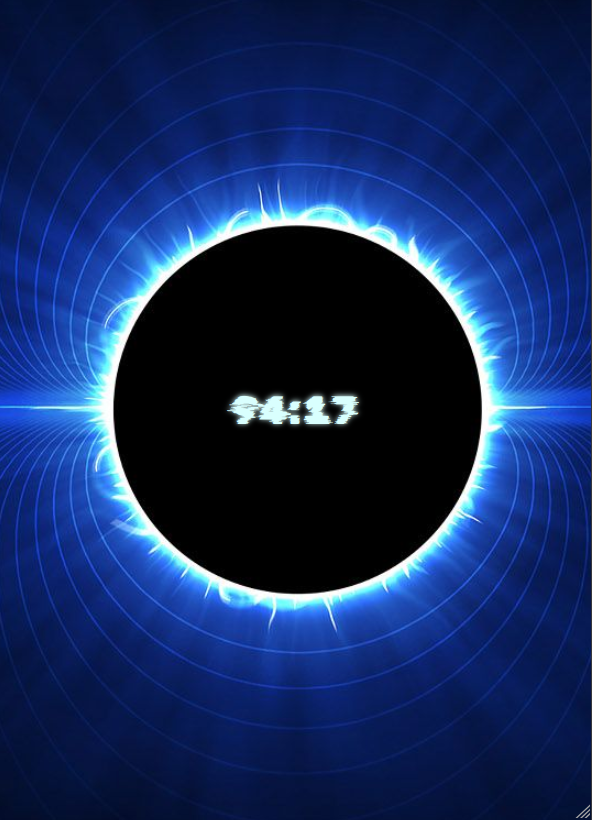

# 100-Hour Clock

Why should a day have only 24 hours?

A different way to experience time. This clock transforms your regular 24-hour day into a 100-hour system, giving you a new perspective on daily planning and time management.

**Live Preview:** [100-hour-clock.vercel.app](https://100-hour-clock.vercel.app/)

## Screenshots
> It was taken at `10:36 PM`



## Features

- 100-hour time system
- Real-time clock
- Alternative perspective on daily planning
- Responsive interface

## Built With

- React
- TypeScript
- Tailwind CSS
- React Router

## Getting Started

Follow these steps to run the project locally.

### Prerequisites

Make sure you have installed:

- [Node.js](https://nodejs.org/)
- [Git](https://git-scm.com/)

### Installation

**1. Clone the repository**

```bash
git clone https://github.com/TohidEq/100-hour-clock
```

**2. Navigate to the project directory**

```bash
cd 100-hour-clock
```

**3. Install dependencies**

```bash
npm install
```

**4. Start the development server**

```bash
npm start
```

**5. Open the application**

Visit [http://localhost:3000](http://localhost:3000) in your browser.

## Available Scripts

| Command | Description |
|---|---|
| `npm start` | Start development server |
| `npm run build` | Create production build |
| `npm test` | Run tests |

## License

This project is open source. See the [LICENSE](LICENSE) file for details.
